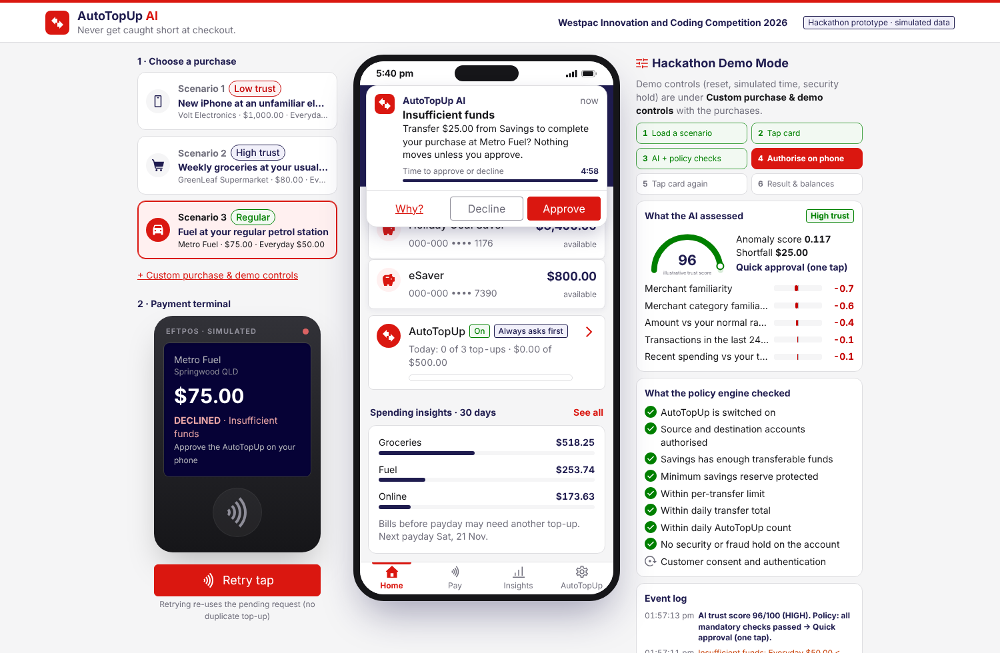
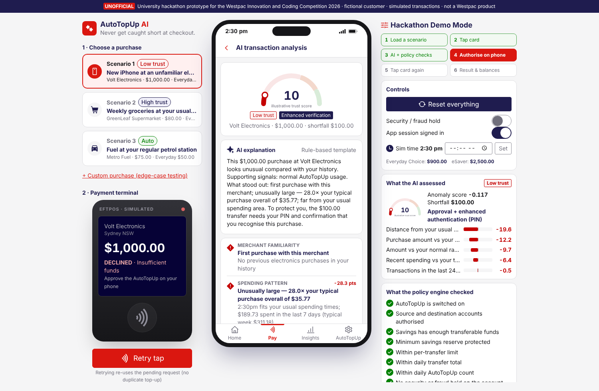
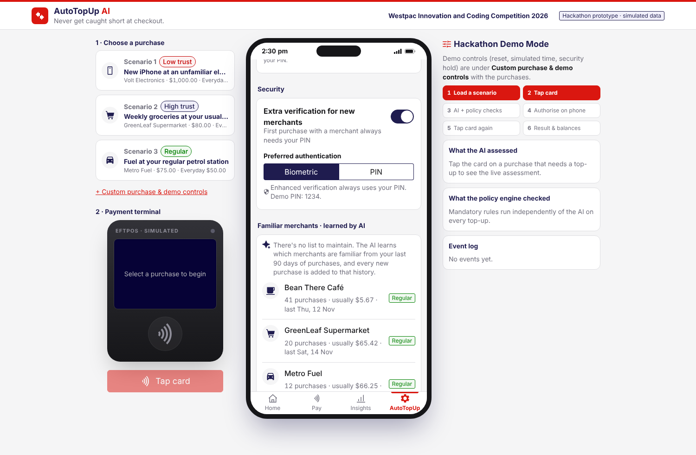

# AutoTopUp AI

**Never get caught short at checkout.**

A working hackathon prototype built for the **Westpac Innovation and Coding Competition 2026**.

> **Hackathon prototype.** Built for a Westpac competition; not a live Westpac product. It uses a fictional customer ("Riley Carter"), fictional merchants and simulated transactions only. No real bank APIs, credentials or customer data are used.

---

## The problem

A customer taps their card for $80 of groceries. They have $65 in their everyday account and $1,200 in savings. The card declines. To fix it they have to unlock their phone, open the banking app, authenticate, find transfers, pick two accounts, type an amount, confirm, go back to the terminal and tap again — about ten steps while a queue waits behind them.

## The solution

AutoTopUp AI notices the insufficient-funds decline, works out the shortfall, and offers to move exactly that amount from the customer's own linked savings. An AI model checks how normal the purchase looks for this customer. A separate rules engine checks the customer's limits and safety controls. Together they pick the lightest safe way for the customer to authorise the transfer. **AutoTopUp never moves money on its own:** every request asks the customer to approve or decline, and gives them a 5-minute window to decide. If they don't respond, the request expires and nothing moves.

There is no "trusted merchant" list to maintain. The AI learns which merchants are familiar from the customer's last 90 days of purchases, and every new purchase is added to that history.

| Situation | What the customer does |
|---|---|
| **High trust** (merchant recognised from purchase history, normal amount, signed in, within one-tap hours) | One tap on "Approve" (or "Decline"). |
| **Medium trust** | Approve, then confirm with biometrics or PIN. |
| **Low trust** (unfamiliar merchant, unusual amount, unusual place) | Approve, confirm they recognise the purchase, and enter their PIN. |
| **Any mandatory rule fails** | No top-up is offered. The AI score cannot change this. |

**AutoTopUp only moves the customer's existing money between their own accounts. It never issues a loan, provides credit or creates an overdraft.**

---

## Quick start

**Requirements:** Python 3.11+ and Node 20+.

```bash
# 1. Backend (API + AI model) — http://localhost:8000
cd backend
python -m venv .venv && source .venv/bin/activate      # Windows: .venv\Scripts\activate
pip install -r requirements.txt
python -m uvicorn app.main:app --reload --port 8000

# 2. Frontend (in a second terminal) — http://localhost:5173
cd frontend
npm install
npm run dev
```

Open **http://localhost:5173**. On macOS or Linux, `./dev.sh` starts both servers at once.

On first start the backend seeds the fictional customer. If the shipped model file is missing or doesn't match your scikit-learn version, it retrains the AI model automatically (about 5 seconds). To retrain by hand:

```bash
cd backend && python -m app.ml.trust_engine     # writes data/trust_model.joblib + data/synthetic_transactions.csv
```

### Single-service mode (simplest for demos and deployment)

```bash
cd frontend && npm install && npm run build      # creates frontend/dist
cd ../backend && python -m uvicorn app.main:app --port 8000
```

FastAPI serves the built React app and the API together at **http://localhost:8000**.

### Deploy for free

The included `Dockerfile` builds a single container. It works on Render, Railway, Fly.io, Google Cloud Run and similar hosts. Point the host at the repository root, choose Docker, and expose port `8000` (or set `PORT`).

### Run the tests

```bash
cd backend && python -m pytest -q        # 45 tests
```

---

## Demo walkthrough (about 4 minutes)

On a laptop screen (≥1280px wide) you'll see three columns: **payment terminal** on the left, the **customer's phone** in the middle, and the **Hackathon Demo Mode** panel on the right (live AI assessment, policy checks and event log). On smaller screens the terminal lives in the phone's **Pay** tab and the demo panel opens from the **Demo** button.

Clicking a scenario card resets the fictional balances for that scenario. Your settings are kept. **Reset everything** also restores the default settings.

**Scenario 2 — High trust, quick approval** (Everyday $65 · Savings $1,200 · groceries $80)
1. Click *Weekly groceries* → **Tap card**. The terminal declines; the AI scores about 97/100.
2. The phone shows: *"Insufficient funds. Transfer $15.00 from Savings…"* → **Approve** → **Approve $15.00 transfer**. No PIN is needed.
3. **Tap card again** → approved. Everyday $0.00 · Savings $1,185.00. The transfer and the purchase are both recorded.

**Scenario 1 — Low trust, enhanced authentication** (Everyday $900 · Savings $2,500 · iPhone $1,000 at an unfamiliar Sydney store)
1. **Tap card** → declined. The AI scores about 10/100 and flags a first-time merchant, an amount 28× larger than usual, and a location about 730 km away.
2. Tap **Why?** to show the full AI analysis (Screen 4), then **Continue to approval**.
3. Tick *"I recognise this purchase"* and enter PIN **1234**. Try a wrong PIN first to show the attempt counter; three wrong PINs lock the top-up.
4. **Tap card again** → approved. Everyday $0.00 · Savings $2,400.00.

**Scenario 3 — Very high trust, regular merchant** (Everyday $50 · Savings $800 · fuel $75 at the regular station)
1. **Tap card** → declined. The AI scores about 96/100 and recognises Metro Fuel from 12 visits in the purchase history.
2. The phone still asks: *"Transfer $25.00 from Savings…? Nothing moves unless you approve."* A countdown shows the 5-minute approval window.
3. **Approve** → one tap → **Tap card again** → approved. Everyday $0.00 · Savings $775.00.
4. Tap **Tap again** to show that the customer isn't charged twice.

**Showing the controls (optional)**
All demo controls (reset, simulated time, security hold, app sign-in) are under **+ Custom purchase & demo controls** in the purchase column.
- **Simulated time 23:30**, then replay Scenario 3. It's outside the one-tap hours, so the customer must confirm with biometrics or PIN.
- **Security hold ON**, then replay Scenario 3. It is blocked even though the trust score is 96.
- **Custom purchase:** $290 at Metro Fuel. The merchant is familiar but the amount is unusual, so one-tap approval isn't offered.
- **Learning from history:** buy at QuickBite Burgers (a new merchant, so PIN required). Then open **Settings → Familiar merchants**: QuickBite now appears, and the next purchase there is no longer treated as a first visit.
- **Approval window:** start a top-up and don't respond. When the countdown reaches 0:00 the request expires and no money moves.

Prototype PIN: **1234**. Biometrics are simulated.

---

## Architecture overview

```
┌──────────── React + TypeScript (Vite) · Westpac GEL design system (@westpac/ui, WBC theme) ─────────┐
│ Terminal  ·  Phone: Dashboard / Pay / AI Analysis / Approve+Auth / Result / Insights / Settings  ·  Demo panel │
└───────────────────────────────────────────────┬─────────────────────────────────────────────────────┘
                                                │ JSON over /api  (integer cents everywhere)
┌───────────────────────────────────────── FastAPI + Pydantic ─────────────────────────────────────────┐
│  Payment orchestration (service.py) — intent state machine, idempotent taps, atomic transfers       │
│        │                         │                                  │                               │
│        ▼                         ▼                                  ▼                               │
│  AI trust engine          Deterministic policy engine          Explanation layer                    │
│  (ml/trust_engine.py)     (policy.py)                          (explain.py)                         │
│  Isolation Forest on      mandatory checks → workflow          template (offline) +                 │
│  10 behavioural features  QUICK / STANDARD /                   generated locally, no API key        │
│  → trust 0-100 + factors  ENHANCED / BLOCKED                   with silent fallback                 │
│        │                                                                                            │
│  Financial-health outlook (bills, payday, reserve) — deterministic                                  │
└───────────────────────────────────────────────┬─────────────────────────────────────────────────────┘
                                                ▼
                     SQLite: accounts · transactions · payment_intents · topup_offers ·
                             notifications · scheduled bills/income · audit · settings (kv)
```

More detail: [`docs/ARCHITECTURE.md`](docs/ARCHITECTURE.md) · [`docs/AI.md`](docs/AI.md) · [`docs/DESIGN-SYSTEM.md`](docs/DESIGN-SYSTEM.md) · [`docs/LIMITATIONS.md`](docs/LIMITATIONS.md)

### Request flow for one card tap

1. `POST /api/payments` creates a **payment intent**, which acts as the idempotency key for the purchase.
2. `POST /api/payments/{id}/tap`:
   - **Enough funds:** the purchase is charged.
   - **Not enough funds:** the AI assesses the purchase, then the policy engine evaluates it. A **top-up offer** is created with a workflow.
     - `BLOCKED` → declined with reasons.
     - Anything else → a push-style request is sent to the phone with a 5-minute approval window. Money never moves without the customer's approval.
3. `POST /api/topups/{id}/approve`:
   - Every mandatory rule is re-checked against fresh balances.
   - The required authentication is verified (the stricter of the original and fresh workflow wins).
   - The transfer runs.
4. The customer taps again → the purchase is charged. Further taps return the original receipt.

---

## Design system

The interface is built on Westpac's open-source **GEL design system** ([GEL-next](https://github.com/WestpacGEL/GEL-next), MIT licence), using the **WBC theme only**.

- **Packages:** `@westpac/ui` 1.21 and `@westpac/style-config` 1.0, installed with the official PostCSS setup (Tailwind 4.1).
- **Tokens:** official WBC colours (primary `#DA1710`, hero navy `#1F1C4F`), GEL's 6px spacing grid, typography scale, radii and breakpoints.
- **Components:** GEL's own components (Button, FlexiCell, Switch, InputGroup, Select, CheckboxGroup, ButtonGroup, Badge, Alert, ProgressBar) and GEL icons throughout.
- **Original elements:** the product mark is our own and no Westpac logo is used. The Westpac-style header carries a "Hackathon prototype · simulated data" tag.
- **Font:** the licensed Westpac brand font is not bundled, so GEL's system font stack is used.

Details, the token mapping and the axe-core accessibility results are in [`docs/DESIGN-SYSTEM.md`](docs/DESIGN-SYSTEM.md).

## How AI is used

- **Model:** a scikit-learn **Isolation Forest** (unsupervised anomaly detection) trained on **15,000+ synthetic transactions from 260 fictional customers** (`backend/data/synthetic_transactions.csv`).
- **Features** (computed by the same code during training and live scoring):
  - amount vs. the customer's typical spend in that category
  - robust deviation from their normal range
  - merchant visit count
  - category familiarity
  - distance from their usual spending area
  - time-of-day pattern
  - purchases in the last 1 h and 24 h
  - 7-day spend vs. a typical week
  - recent AutoTopUps
- **Trust score:** the anomaly score is squashed to an *illustrative* 0–100 scale. Bands: 85–100 high, 60–84 medium, 0–59 low. **This is not a fraud probability** and the thresholds are prototype values, not validated banking risk thresholds.
- **Explainability:** for every assessment, each feature is reset to a typical value and the model is re-scored. The difference shows how many trust points that feature added or removed. The app groups these into five areas: merchant, spending, location, account behaviour and financial health. A plain-English explanation is generated from the same facts.
- **Runs fully locally:** the model, the scores and the plain-English explanation are all produced on your machine. No API key, external AI service or internet connection is needed, and no customer data leaves the app.
- **Synthetic hold-out evaluation (illustrative only):** about 98% of injected anomalies scored low-trust, compared with about 5–6% of ordinary purchases.

Full details: [`docs/AI.md`](docs/AI.md).

## Security and policy rules (always enforced, independent of the AI)

AutoTopUp enabled · source/destination accounts authorised · savings has enough · minimum savings reserve protected · per-transfer limit · daily total limit · daily count limit · no security hold · consent + authentication complete.

Additional escalations:
- An unfamiliar merchant requires enhanced authentication (if that setting is on).
- Three or more requests in 24 h require enhanced authentication.
- One-tap approval needs every condition to hold: high trust, a merchant recognised from purchase history, signed in, within one-tap hours, bills still covered, and no repeated requests. Otherwise biometrics or PIN is required.
- A familiar merchant never turns an unusual purchase into a one-tap approval.

Robustness:
- Retries re-use the pending offer.
- Approving twice is a no-op.
- Paying twice returns the original receipt.
- PINs lock after 3 failures.
- Every request has a real-time 5-minute approval window. When it ends unanswered, the request expires and no money moves.
- All money is integer cents with conditional SQL updates, so balances can never go negative or move twice.

## Customer settings (all of them change decisions)

- On/off
- Source and destination accounts
- Maximum per transfer
- Maximum per day (amount and count)
- Minimum savings reserve
- One-tap approval on/off, and one-tap hours
- Extra verification for unfamiliar merchants
- Preferred authentication (biometric/PIN)
- Notification preferences

Settings are persisted in SQLite. Familiar merchants are shown read-only in Settings: the AI learns them from purchase history, so there's no list to edit.

## Project structure

```
autotopup-ai/
├── backend/
│   ├── app/
│   │   ├── main.py            FastAPI routes, Pydantic validation, static hosting
│   │   ├── service.py         payment/top-up state machine, transfers, insights
│   │   ├── policy.py          deterministic policy engine
│   │   ├── explain.py         plain-English explanations (generated locally)
│   │   ├── seed.py            fictional customer, merchants, scenarios, history
│   │   ├── db.py              SQLite store + simulated clock
│   │   └── ml/
│   │       ├── features.py    shared feature engineering
│   │       ├── synthetic.py   synthetic population generator
│   │       └── trust_engine.py  Isolation Forest training, calibration, attribution
│   ├── data/                  trained model, synthetic dataset, model metadata
│   ├── tests/                 45 pytest tests
│   └── requirements.txt
├── frontend/src/
│   ├── App.tsx  store.tsx     layout + app state / flow orchestration
│   ├── index.css              GEL Tailwind setup + WBC theme import
│   ├── components/            Terminal, Phone, DemoPanel, AssessmentView, ui
│   ├── screens/               Dashboard, Pay/Analysis/Approve/Result, Insights, Settings
│   └── lib/                   typed API client, formatting
├── docs/                      architecture, AI, design system, limitations
├── frontend/postcss.config.mjs  official GEL PostCSS config
├── Dockerfile  dev.sh
```

## API reference

| Method | Path | Purpose |
|---|---|---|
| GET | `/api/state` | Customer, accounts, settings, transactions, notifications |
| GET/PUT | `/api/settings` | Read/update AutoTopUp settings (validated) |
| POST | `/api/payments` | Create payment intent `{merchant_id, amount_cents}` |
| POST | `/api/payments/{id}/tap` | Simulate a card tap (idempotent) |
| POST | `/api/topups/{id}/approve` | `{method: tap\|biometric\|pin, pin?, biometric_ok?, confirm_recognised?}` |
| POST | `/api/topups/{id}/decline` | Decline a top-up |
| POST | `/api/assess` | Dry-run AI + policy assessment |
| GET | `/api/insights` | Spending insights, unusual transactions, bills, model info |
| POST | `/api/demo/reset` | `{scenario_id, keep_settings, date?}` |
| POST | `/api/demo/clock` · `/api/demo/flags` | Simulated time · security hold / session flags |

Interactive docs: http://localhost:8000/docs

## Known limitations and future integration

See [`docs/LIMITATIONS.md`](docs/LIMITATIONS.md). In short:
- Everything is simulated.
- The ML model is trained on synthetic data and is not validated for real fraud risk.
- Completing the purchase on the *same* tap (instead of tapping again after approving) would need integration with the bank's real-time card authorisation. **This is a concept, not an existing Westpac feature.**
- A production version would also need:
  - real strong customer authentication
  - core-banking transfer APIs
  - fraud-platform signals
  - regulatory, privacy and accessibility review

## Screenshots

| Scenario 3 — approval request with countdown | Scenario 1 — AI analysis | Familiar merchants learned by AI |
|---|---|---|
|  |  |  |
