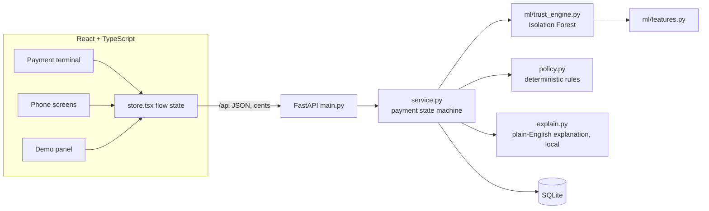
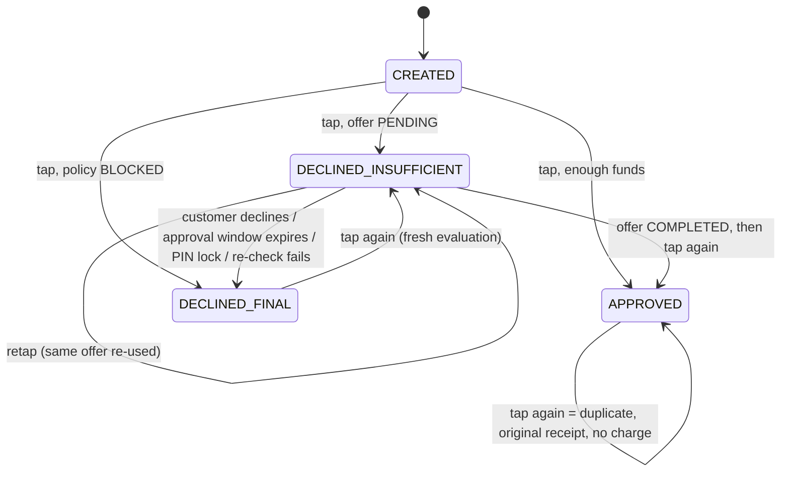

# Architecture

## Components

## Payment intent state machine

**Top-up offer statuses:** `PENDING → COMPLETED | DECLINED | EXPIRED (5 min) | BLOCKED | LOCKED (3 bad PINs)`.

## Consistency guarantees

- **One lock.** Every write runs inside `Database.tx()`, a serialised `BEGIN IMMEDIATE` transaction. Nested calls join the outer transaction, so a whole tap (assessment, offer, transfer, charge, notification) commits or rolls back as one unit.
- **Money can't go negative or move twice.**
  - Balance changes use conditional updates: `UPDATE … SET balance = balance - x WHERE balance >= x`.
  - The schema also enforces `CHECK (balance_cents >= 0)`.
- **Idempotency.**
  - The payment intent id is the idempotency key.
  - A pending offer is re-used on retry.
  - A completed offer returns `duplicate: true`.
  - An approved intent returns its original receipt.
- **Re-check at approval.** Approval re-runs every mandatory check against fresh balances and settings, so time-of-check/time-of-use gaps are closed. Authentication must satisfy the stricter of the original and the fresh workflow.
- **Security-relevant failures persist.** A PIN failure, lock-out, expiry or block is committed before the error is returned, so retrying can't reset the attempt counter.
- **Atomic demo reset.** Readers never see a half-seeded database.
- **Integer cents** throughout: backend, database, API and frontend. Values are formatted only for display.

## Simulated clock

`kv.sim_now` holds Brisbane local time. Each scenario starts at a fixed time of day (14:30, 10:15 and 17:40), and the clock ticks forward a few seconds with each event. The demo panel can set the time, for example to show the automatic-hours rule. Seeded history is generated relative to this clock with a fixed random seed, so the demo is repeatable on any date.

## Data model (SQLite)

| Table | Contents |
|---|---|
| `accounts` | Everyday Choice, eSaver and Holiday Goal Saver, with balance in cents |
| `transactions` | Purchases, income, bills and transfers. `is_autotopup` flags AutoTopUp transfers; `ref` links a purchase to its intent and a transfer to its offer |
| `payment_intents` | One row per purchase attempt (idempotency key) |
| `topup_offers` | Workflow, trust score, the full assessment JSON, the policy JSON, PIN failures and expiry |
| `scheduled` | Upcoming bills and income, used for the financial-health outlook |
| `notifications` | Push-style messages |
| `audit` | Resets, offers, approvals, declines and settings changes |
| `kv` | Settings, simulated clock, security hold, app-session flag |

## Frontend

- **Layout.** At ≥1280px the screen has three columns (terminal · phone · demo panel). On smaller screens the phone is full-screen, the terminal is in the Pay tab, and the demo panel is a drawer.
- **State.** `store.tsx` holds the flow state:
  `idle → processing → assessing → awaiting → transferring → retap → approved`, plus `blocked`, `topup_declined` and `duplicate`.
- **Pacing.** Short deliberate delays let an audience watch each stage. They don't affect correctness.
- **Accessibility.**
  - Status always comes with an icon and text, never colour alone.
  - Toggles use `role="switch"`.
  - Notifications use `role="alert"`.
  - Reduced-motion preferences are respected.
- **Charts.** Category and weekly bars are single-series charts with hover tooltips.
